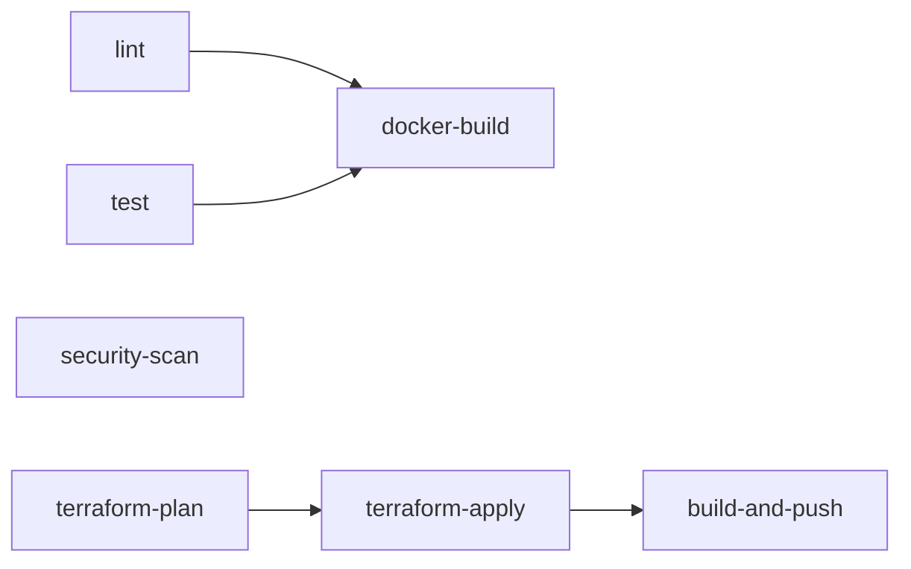

# CI/CD Pipeline — Golden Path Reusable Workflow

`.github/workflows/golden-path-ci.yml` is a reusable workflow (`on: workflow_call`) that gives any service team the same lint, test, security, IaC and container checks, plus an optional deploy path to AWS. A service adopts it by adding a small caller workflow (see [How to adopt](#how-to-adopt)).

## Pipeline overview



`docker-build` runs on pull requests only. `terraform-apply` and `build-and-push` run only when the caller enables them (push to `main`).

## Inputs and secrets

| Name                    | Type    | Default   | Purpose                                           |
| ----------------------- | ------- | --------- | ------------------------------------------------- |
| `node_version`          | string  | `"20"`    | Node.js version for `lint` and `test`             |
| `terraform_version`     | string  | `"1.7.0"` | Terraform version installed by the Terraform jobs |
| `run_terraform_plan`    | boolean | `false`   | Enables `security-scan` and `terraform-plan`      |
| `run_terraform_apply`   | boolean | `false`   | Enables `terraform-apply`                         |
| `build_and_push`        | boolean | `false`   | Enables `build-and-push`                          |
| `aws_role_arn` (secret) | string  | none      | IAM role assumed through OIDC                     |

## Jobs and why they exist

| Job               | Runs when                                     | What it does                                                                                                                                                                           | Why it exists                                                                                                            |
| ----------------- | --------------------------------------------- | -------------------------------------------------------------------------------------------------------------------------------------------------------------------------------------- | ------------------------------------------------------------------------------------------------------------------------ |
| `lint`            | always                                        | Runs `npm run lint` for `packages/backend` and `packages/frontend`                                                                                                                     | Catches style and obvious code errors before review                                                                      |
| `test`            | always                                        | Runs backend Jest with coverage and writes a coverage table to the job summary                                                                                                         | Proves behaviour and enforces the 80% coverage threshold (lines and branches) defined in `packages/backend/package.json` |
| `security-scan`   | `run_terraform_plan`                          | Runs `checkov -d infra --hard-fail-on HIGH`                                                                                                                                            | Blocks insecure infrastructure before it is planned or applied                                                           |
| `terraform-plan`  | `run_terraform_plan`                          | Assumes the AWS role via OIDC, installs Terraform, runs `init` and `plan` in `infra/stacks/dev`, publishes the plan to the job summary and uploads it as the `terraform-plan` artifact | Shows reviewers exactly what infrastructure will change, and hands the same plan to `terraform-apply`                    |
| `docker-build`    | pull requests, after `lint` and `test`        | Builds the backend and frontend images without pushing                                                                                                                                 | Validates the Dockerfiles on every PR without needing AWS credentials                                                    |
| `terraform-apply` | `run_terraform_apply`, after `terraform-plan` | Assumes the role via OIDC, removes the mock-provider `skip_*` lines, initialises the S3 backend, applies the saved plan, and reports the load balancer URL                             | Applies the plan that was reviewed rather than a fresh one                                                               |
| `build-and-push`  | `build_and_push`, after `terraform-apply`     | Reads the ECR URLs from Terraform outputs, builds and pushes both images (tagged with the commit SHA and `latest`), then forces a new ECS deployment                                   | Ships the application onto the infrastructure that was just provisioned                                                  |

## Required checks

Mark these as required status checks in branch protection for `main` so a PR cannot merge unless they pass.

| Check            | What it validates                                 | Why it is required                                              |
| ---------------- | ------------------------------------------------- | --------------------------------------------------------------- |
| `lint`           | Source follows the ESLint rules                   | Keeps code quality consistent across teams                      |
| `test`           | All tests pass and coverage is at least 80%       | Prevents untested changes from reaching `main`                  |
| `security-scan`  | Checkov finds no HIGH severity issues in `infra/` | Stops insecure infrastructure from being merged                 |
| `terraform-plan` | Terraform initialises and produces a valid plan   | Proves the IaC is deployable and shows the impact of the change |

`docker-build` is a recommended additional check: it confirms the images still build.

## How to adopt

1. Copy the caller below to `.github/workflows/todo-service-ci.yml` (rename it for your service).
2. Make sure your repo has the same layout: `packages/backend`, `packages/frontend`, a Dockerfile in each, and a Terraform stack in `infra/stacks/dev`.
3. Add the `AWS_ROLE_ARN` secret (see [Configuring secrets](#configuring-secrets-oidc-role-arn)).
4. Open a PR, then add the checks above as required in branch protection.

Minimum caller:

```yaml
name: Todo Service CI

on:
  push:
    branches:
      - main
  pull_request:

permissions:
  contents: read
  pull-requests: write
  id-token: write # required here: GitHub only issues the OIDC token if the caller requests it

jobs:
  call-golden-path:
    uses: ./.github/workflows/golden-path-ci.yml
    with:
      node_version: "20"
      run_terraform_plan: true
      run_terraform_apply: ${{ github.event_name == 'push' && github.ref == 'refs/heads/main' }}
      build_and_push: ${{ github.event_name == 'push' && github.ref == 'refs/heads/main' }}
    secrets:
      aws_role_arn: ${{ secrets.AWS_ROLE_ARN }}
```

To run only lint, test and the Docker build (no AWS), drop `run_terraform_plan`, `run_terraform_apply`, `build_and_push` and the `secrets` block.

To call the workflow from another repository, use `uses: <org>/<repo>/.github/workflows/golden-path-ci.yml@<tag>`.

## Configuring secrets (OIDC role ARN)

The workflow uses OpenID Connect, so no long-lived AWS keys are stored in GitHub. The `terraform-plan`, `terraform-apply` and `build-and-push` jobs exchange a short-lived GitHub token for temporary AWS credentials with `aws-actions/configure-aws-credentials@v4`.

1. **AWS side (one time per account):**
   - Add an IAM OIDC identity provider for `token.actions.githubusercontent.com` with audience `sts.amazonaws.com`.
   - Create an IAM role whose trust policy allows `sts:AssumeRoleWithWebIdentity` for that provider, restricted to your repository (`token.actions.githubusercontent.com:sub` like `repo:<owner>/<repo>:*`).
   - Attach the permissions the pipeline needs (Terraform state bucket access, and the services the stack manages such as ECS, ECR, ELB, EC2, IAM and CloudWatch Logs).
2. **GitHub side:** in the repository go to Settings, Secrets and variables, Actions, and add a repository secret named `AWS_ROLE_ARN` with the role's ARN (`arn:aws:iam::<account-id>:role/<role-name>`).
3. **Pass it through:** the caller maps `secrets.AWS_ROLE_ARN` to the reusable workflow's `aws_role_arn` secret. Inside `golden-path-ci.yml`, always reference `secrets.aws_role_arn`, never `secrets.AWS_ROLE_ARN`.
4. **Permissions:** `id-token: write` must be set at the top level of the caller workflow. Setting it only in the reusable workflow is not enough and the job fails with a permissions error.

## Conventions

- Actions are pinned to version tags (for example `actions/checkout@v4`), not commit SHAs.
- `actions/setup-node` does not use `cache: 'npm'` because the repo has no lock files.
- Workflows use least-privilege `permissions:` blocks, and only the jobs that need OIDC request `id-token: write`.
- Terraform state lives in the shared S3 bucket; the key is injected at `terraform init` as `todo-service/<repository_owner>/dev/terraform.tfstate`.
